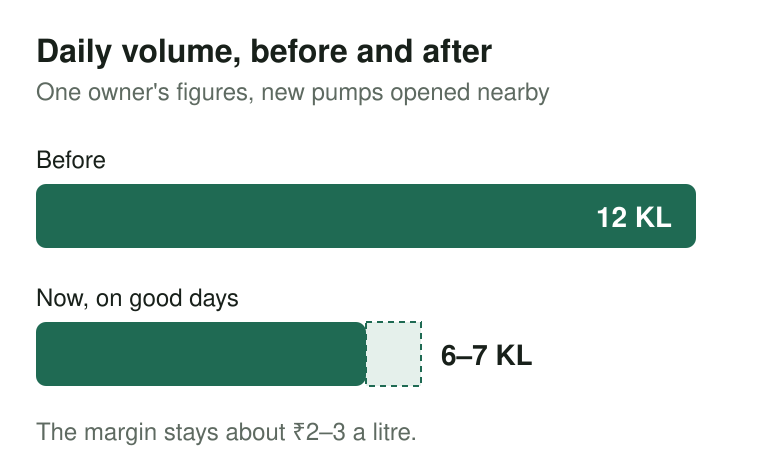
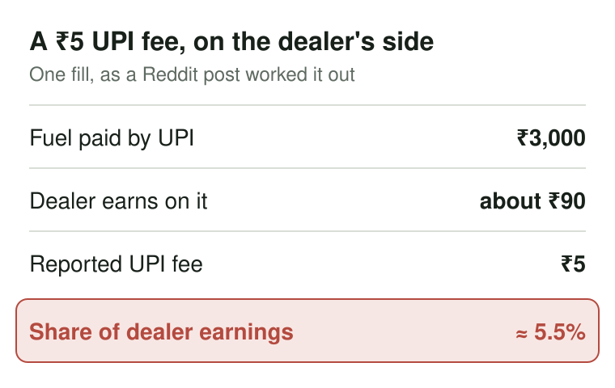

"Managing staff and accounting."

That was the answer an owner of two Indian Oil pumps in a tier 3 town gave when someone asked about his biggest headaches in an August 2026 r/IndiaBusiness AMA. His family had been in the business for roughly 40 years. He also named cash flow, specifically having cash for the next order.

It's a short answer for something that can keep you in the pump office at 10:30 pm. The fuel has gone out. People have handed over cash and payment figures. You still need to work out whether everything adds up, and whether you can pay for the next load.

One Reddit conversation isn't a survey of Indian dealers. But read it alongside the dealer news this year, and the same worries keep coming back. There is money moving through the station all day. Knowing how much of it you actually have is harder.

## Big sales figures don't mean much breathing room

The owner put his margin at around ₹2–3 per litre and net earnings at roughly ₹3 lakh a month across both pumps.

His warning was blunt. "Your revenues gonna be high but profit margin is very thin. I have seen people go bankrupt."

He said daily volume had fallen from 12 KL to 6–7 KL on good days because many new pumps had opened nearby. That's 12,000 litres down to 6,000–7,000. A busy-looking forecourt can still belong to a business whose sales have almost halved.

<figure>

<figcaption>Roughly half the litres, at the same thin margin per litre.</figcaption>
</figure>

You can understand why an owner gets irritated when someone sees the day's turnover and assumes they're doing wonderfully. Most of that money isn't theirs to keep.

September's UPI fee reports touched the same nerve. Dealers in several states said they would refuse large UPI payments or go cash-only over a fee reported as ₹5 on fuel payments, due from mid-October. One Reddit post worked it out this way: about ₹90 of dealer earnings on ₹3,000 of fuel, with ₹5 taking roughly 5.5% of that. A customer may see a small charge. The dealer sees a cut from an already thin margin.

<figure>

<figcaption>Small for the customer; a real bite of what the dealer earns on the fill.</figcaption>
</figure>

## The next order needs cash, not promises

In March, during the West Asia and Hormuz supply scare, IOCL, BPCL and HPCL paused dealer credit and asked for advance payment. Dealers warned of a cash crunch.

The difference between a sale and money available to spend becomes painfully clear then. Fuel supplied on credit counts as business done. It doesn't pay for tomorrow's order until the customer pays you.

The AMA owner's warning was "if you give credit to local business they might never return it and gov will always delay". He described fleet and bus credit customers as the "worst customer you can deal with".

Anyone who has run a credit book knows the type. The bus operator who fills every morning and pays "next week", for months.

By May, dealers were also reporting supply cuts and short indents. Rajasthan dealers threatened a strike from June 1, and dealers said OMCs were pushing costlier premium petrol. An owner could arrange the money and still worry about what supply would arrive.

For you or your manager, the khata needs to answer a plain question: who owes what today? A sales total alone won't tell you how much cash you can put towards an order.

## Ten people report money, and you have to believe the total

"Accounting is tough because 10 diff people report and collect cash and give credit, so you can guess."

That's the line from the AMA that stuck with us. Ten pairs of hands, every day, and one owner at the end trying to make the numbers meet.

He caught staff taking cash and covering the gap with inflated Paytm or UPI figures. Staff also used personal QR codes. His response was to give each attendant their own QR and use an app that showed which person each payment went to.

He checked opening and closing meter readings, credit and UPI, then tallied them against the meter. He said that check helped him catch a staff fraud.

Suspicion is exhausting, and it can be unfair to honest workers. A shortage should lead to a particular handover and its records, rather than an argument with everyone on the shift.

Customers can cheat too. The owner described two teenagers showing a fake UPI payment screen; he caught them on their second attempt. A screen shown at the nozzle and money received by the station are different things.

Then there are problems an attendant can't settle. In August, Tamil Nadu dealers threatened to stop UPI after police froze pump bank accounts over customers' cybercrime-linked payments. Even a payment that reaches the account can bring another worry.

## The stock worries don't stop at the meter

The owner's E20 worry was water. Even a bit of leakage, he said, "would contaminate all of stock". So he checks density every day.

In July, dealers raised monsoon moisture contamination concerns around E20 and asked for testing procedures and tools. This isn't something a tidy sales report can resolve. You need to know what's happening in the tank.

The owner also made a sharp observation about reputation: customers choose which pump to avoid based on staff behaviour and malpractice. You may be checking accounts in the office while an attendant's conduct gives someone a reason never to return.

That makes staff management more complicated than catching theft. You need workers you can trust with money and with the customer standing in front of them.

## Taking over the family bunk means learning where to look

Another August thread came from someone taking over a bunk their father had started in 2013 as a side business. Their father's health was failing. They wanted to learn "how to look at the accounts, deal with workers, check daily sales and stock, understand where the money is going".

Read that list again. It's the whole job.

If you're taking over from a parent, it can feel awkward to ask basic questions about a business your family has owned for years. Ask anyway. Have someone walk you through a shift's meter readings and the money received against those sales. An explanation you can't follow won't help you close the next day.

Even the two-pump owner said his paperwork had been manual until recently. He now used a generic accounting tool that carried the closing meter reading into the next shift's opening. Forty years in, and carrying one number from one shift to the next was still worth mentioning. That tells you how much of this work still lives in registers.

## Where we think PumpOS can help

We built PumpOS around these daily checks. Nozzle opening readings carry forward from the last closing; closing minus opening gives fuel sold. Each attendant has a drawer with an opening float and recorded cash drops. At handover, expected cash is compared with cash handed over, so a shortage has a name and a time. Card, UPI and credit stay separate from drawer cash. [See how shift drawers reconcile](/features/shifts-and-drawers).

[Customer ledgers](/features/credit-and-khata) show credit sales, collections and running balances. [Tank dips are compared with expected stock](/features/stock-and-dips), and a variance needs a reason. The Daily Station Sales Report stays saved at day close, never recalculated. Office collections, expenses and supplier payments go in the Daily Cash Book. Our [day closing and DSR guide](/blog/day-closing-and-dsr-guide/) walks through the whole close step by step.

PumpOS doesn't fix margins, E20 contamination, OMC policy or UPI rules. It helps you keep track of the parts you have to account for yourself.

We'd like to hear how your station closes the day, especially the bit that still keeps you at the desk after everyone else has handed over. [Book a short demo](/demo) and walk us through it.
